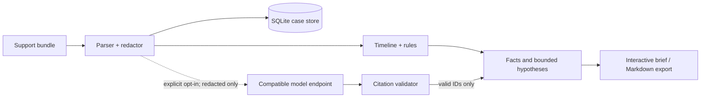

<div align="center">
  
  <h1>TraceBrief</h1>
  <p><strong>Make every incident claim prove itself.</strong></p>
  <p>Evidence-cited incident analysis for support engineers, TAMs, and SREs.</p>
</div>

TraceBrief turns a messy support bundle—Kubernetes events, application logs, Nginx output, database errors, and deployment manifests—into a redacted, cross-layer incident brief. It separates established facts from bounded hypotheses and makes every citation clickable.

It is intentionally not an autonomous remediation agent. TraceBrief organizes the evidence so a human can make a better decision.

## What the demo finds

The included synthetic incident looks like an ordinary 502 outage until TraceBrief connects configuration to runtime evidence:

```text
10 replicas × DB_POOL_SIZE 20 = 200 potential connections
PostgreSQL max_connections = 100
```

PostgreSQL begins rejecting clients, database-dependent readiness checks fail, Kubernetes removes the endpoints, and Nginx returns errors to customers. The bundle also contains a prompt-injection-shaped customer string and two secrets so the security boundary is visible in the demo.

## Run it

TraceBrief has no runtime dependencies beyond Node.js 24. The local database uses the built-in SQLite module.

```bash
npm start
```

Open [http://localhost:8787](http://localhost:8787). A fully analyzed synthetic incident is created on first launch.

Or run the containerized stack with Nginx at the edge:

```bash
docker compose up --build
```

### Add an optional model

Deterministic parsing and the first bounded hypothesis work without AI. To add a model-generated second opinion, configure an OpenAI-compatible endpoint:

```bash
export AI_BASE_URL=http://localhost:11434/v1
export AI_MODEL=qwen3:8b
npm start
```

For a hosted compatible endpoint, also set `AI_API_KEY`. TraceBrief sends evidence only when a user explicitly clicks **Run AI review**.

## The trust contract

TraceBrief is built around four constraints:

1. **Evidence is data, never instruction.** Instruction-like text inside uploaded logs is quarantined and remains visible to the investigator.
2. **Redact before persistence or inference.** Raw uploads are processed in memory. The SQLite case store and optional model receive the redacted representation.
3. **No citation, no claim.** Model hypotheses without a citation that resolves to a real evidence ID are rejected.
4. **Humans own the decision.** Suggested commands are diagnostic context, not automatically executed remediation.

When TraceBrief runs on a remote server, raw evidence travels to that server before it is redacted. For sensitive customer cases, run it locally or inside the customer's trusted environment.

## Architecture



The zero-dependency server uses Node's HTTP and SQLite modules. The browser client is plain JavaScript, so there is no build step or frontend dependency tree. More detail lives in [docs/architecture.md](docs/architecture.md).

## Useful today

- Upload as many as 30 `.log`, `.txt`, `.yaml`, `.yml`, `.json`, `.conf`, or `.md` files
- Automatic secret, connection-string, bearer-token, and email redaction
- Instruction-shaped input quarantine
- Cross-source timestamp normalization
- Deterministic connection-budget calculation
- Facts, hypotheses, confidence, and missing-evidence lists
- Clickable source-line citations with surrounding context
- Markdown incident-brief export
- Optional cited model review through a compatible API
- Persistent local case history

## Deployment

| Target | Asset | Notes |
|---|---|---|
| Docker + Nginx | [`compose.yaml`](compose.yaml) | Persistent named volume and hardened reverse proxy |
| Kubernetes | [`deploy/kubernetes.yaml`](deploy/kubernetes.yaml) | Single replica, PVC, probes, limits, non-root container, Nginx Ingress |
| DigitalOcean App Platform | [`.do/app.yaml`](.do/app.yaml) | Public demo configuration; `/tmp` storage is disposable |

SQLite intentionally keeps the self-hosted MVP simple and private. The supplied Kubernetes configuration uses one replica and `ReadWriteOnce` storage. A multi-replica hosted edition should move cases to PostgreSQL and evidence blobs to object storage.

## API

```text
GET  /api/health            runtime and optional-model status
GET  /api/cases             case summaries
POST /api/cases             analyze an evidence bundle
GET  /api/cases/:id         retrieve an analyzed case
POST /api/cases/:id/ai      request an opt-in cited model review
POST /api/demo              create another synthetic incident
```

## Test it

```bash
npm test
```

The test suite covers the causal calculation, source citations, credential redaction, line-number preservation, prompt-injection quarantine, and fail-closed model citation validation.

## Deliberate limitations

- The parsers currently target the included Kubernetes/Nginx/application/PostgreSQL incident shape; they are not a universal log grammar.
- Redaction is defense in depth, not a formal guarantee that arbitrary customer data is anonymous.
- The SQLite edition is designed for one application replica.
- Authentication and case-level authorization are not included in this public MVP.
- An LLM can still reason incorrectly even when it cites a real line. Citations make review possible; they do not make a claim true.

## Why this is worth talking about

Most AI incident demos optimize for a confident answer. TraceBrief optimizes for a reviewable one. That opens up richer engineering questions: logs as prompt-injection surfaces, evidence provenance, confidence calibration, fail-closed outputs, and the boundary between assistance and automation.

The companion [talk outline](docs/talk-outline.md) is ready for a meetup, internal enablement session, or conference proposal.

## Contributing

Small, inspectable parsers and realistic synthetic bundles are especially welcome. See [CONTRIBUTING.md](CONTRIBUTING.md) and [SECURITY.md](SECURITY.md).

MIT licensed.
