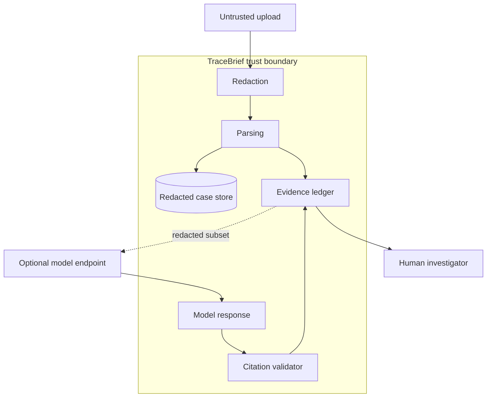

# Architecture

TraceBrief has two analysis lanes that meet at the evidence ledger.

## Deterministic lane

The deterministic lane always runs and requires no network access:

1. Normalize filenames and reject oversized request bodies.
2. Redact credentials, bearer tokens, email addresses, and database URL passwords.
3. Split every source into stable evidence records with source filenames and original line numbers.
4. Detect timestamps, severity, component names, and incident tags.
5. Quarantine instruction-like strings while preserving them for human review.
6. Build a normalized timeline and derive explicit configuration calculations.
7. Emit facts and bounded hypotheses with evidence citations.
8. Persist only the redacted analysis document in SQLite.

The MVP rules deliberately focus on one realistic failure family: application scale, database pool pressure, readiness degradation, and gateway impact. Adding a rule should add evidence, not merely add a keyword-triggered diagnosis.

## Optional model lane

The model lane runs only after an explicit user action and only when `AI_BASE_URL` and `AI_MODEL` are configured.

The model receives a compact projection of redacted evidence. A system message establishes that all evidence is hostile data and requires JSON with evidence IDs. The returned document then passes through a second boundary:

- unknown citations are removed;
- hypotheses with no valid citations are removed;
- if no hypothesis survives, the whole model response fails closed;
- lengths, confidence values, and list sizes are bounded before persistence.

This does not eliminate hallucinations. It makes claims inspectable and prevents uncited prose from entering the incident brief.

## Storage model

The `cases` table contains a small index and one versioned JSON analysis document:

```sql
CREATE TABLE cases (
  id TEXT PRIMARY KEY,
  title TEXT NOT NULL,
  status TEXT NOT NULL,
  created_at TEXT NOT NULL,
  analysis_json TEXT NOT NULL
);
```

SQLite is a conscious local-first choice for the MVP. A hosted, multi-user architecture would separate:

- case metadata and evidence indexes in PostgreSQL;
- encrypted evidence blobs in object storage;
- asynchronous parsing and model work in a job queue;
- user identity, organization membership, and case authorization at the API boundary.

## Security boundaries



Uploads and model output are both untrusted. Deployment authentication is out of scope for this public MVP, so it should not be exposed with customer data without an authentication layer.

## Scaling path

The first production evolution would introduce a storage interface backed by PostgreSQL, then move parsing to a worker. The web tier could scale horizontally while one job atomically claims an analysis. Evidence content should be encrypted separately from search metadata so retention and deletion policies remain tractable.
